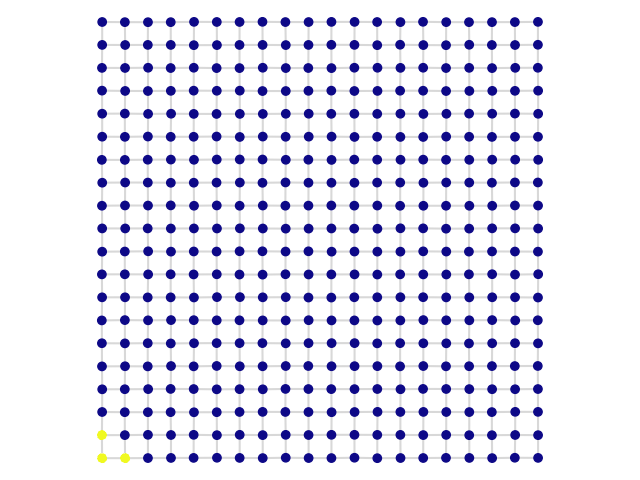
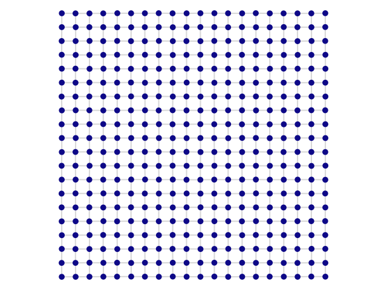
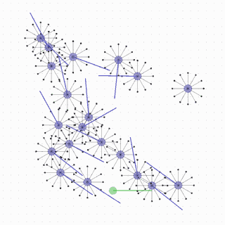

<div align="center">

# Phyelds Examples

Runnable examples of [phyelds](https://github.com/phyelds/phyelds), the pythonic
aggregate computing toolkit: write one program for the whole network, watch
collective behaviour emerge.

[](https://phyelds.github.io/phyelds/)
[](https://pypi.org/project/phyelds/)
[](https://colab.research.google.com/github/phyelds/phyelds-examples/blob/main/binder/phyelds-example.ipynb)
[](https://mybinder.org/v2/gh/phyelds/phyelds-examples/HEAD?labpath=binder%2Fphyelds-example.ipynb)

</div>

| Channel | Self-organising coordination regions | Vicsek flocking (VMAS) |
|:---:|:---:|:---:|
|  |  |  |
| [`src/channel.py`](src/channel.py) | [`src/scr.py`](src/scr.py) | [`src/VicsekFlocking.py`](src/VicsekFlocking.py) |

## The examples

| Example | What it shows | Building blocks |
|---|---|---|
| [`counter.py`](src/counter.py) | Every device counts its own rounds: the smallest stateful program | `remember` |
| [`channel.py`](src/channel.py) | The devices between a source and a target form a band, the shortest path between them | `distance_to`, `collect_or` |
| [`scr.py`](src/scr.py) | The network splits into areas, each with an elected leader, and every device learns the size of its area | `elect_leaders`, `count_nodes`, `broadcast` |
| [`VicsekFlocking.py`](src/VicsekFlocking.py) | 20 robots align their headings with their neighbours (Vicsek model) in the [VMAS](https://github.com/proroklab/VectorizedMultiAgentSimulator) physics simulator | `neighbors`, `phyelds.vmas` |

The whole channel is one function, run by every device:

```python
@aggregate
def channel() -> float:
    distances = neighbors_distances()
    target_distance = distance_to(sense("target"), distances)
    nodes_in_path = collect_or(target_distance, sense("source"))
    distance_from_path = distance_to(nodes_in_path, distances)
    return 1.0 if distance_from_path < CHANNEL_WIDTH else 0.0
```

## Try it without installing anything

Open the notebook in [Colab](https://colab.research.google.com/github/phyelds/phyelds-examples/blob/main/binder/phyelds-example.ipynb)
or [Binder](https://mybinder.org/v2/gh/phyelds/phyelds-examples/HEAD?labpath=binder%2Fphyelds-example.ipynb):
it installs phyelds and its simulator (`phyelds-simulator`) and runs the channel,
drawing the network live.

## Run them locally

The examples need Python 3.12 or 3.13 and [Poetry](https://python-poetry.org/):

```bash
poetry install
poetry run python src/counter.py
poetry run python src/channel.py
poetry run python src/scr.py
poetry run python src/VicsekFlocking.py   # VMAS: installs PyTorch, renders with pyglet
```

The VMAS example renders through pyglet, so it needs a display (or a virtual one,
such as `xvfb-run`).

The examples require phyelds 8.11 or newer (below 9.0). Vicsek flocking reads
`agent.sense()` and sends `action.send(...)` through the typed objects shared
with the VMAS host. Each robot sends an action every round, before the next
physics step.

To check the Vicsek example without rendering:

```bash
PYTHONPATH=src poetry run python -m unittest discover -s tests -v
```

`counter`, `channel` and `scr` save an `.mp4` video (it needs
[ffmpeg](https://ffmpeg.org/)) and `channel` and `scr` also a PDF of the last frame,
styled for papers by [`CustomRenderMonitor`](src/CustomRenderMonitor.py). The
Vicsek example saves `vicsek.gif` and one PDF per frame.

To regenerate the animations at the top of this page:

```bash
poetry run python src/readme_gifs.py
```

## Learn more

- [Tutorial](https://phyelds.github.io/phyelds/tutorial/): the gradient, step by step.
- [Simulator](https://phyelds.github.io/phyelds/simulator/): deployments, neighbourhoods and rendering.
- [Case study: VMAS](https://phyelds.github.io/phyelds/integration/vmas/): how
  `phyelds.vmas` drives the robots of the Vicsek example.
